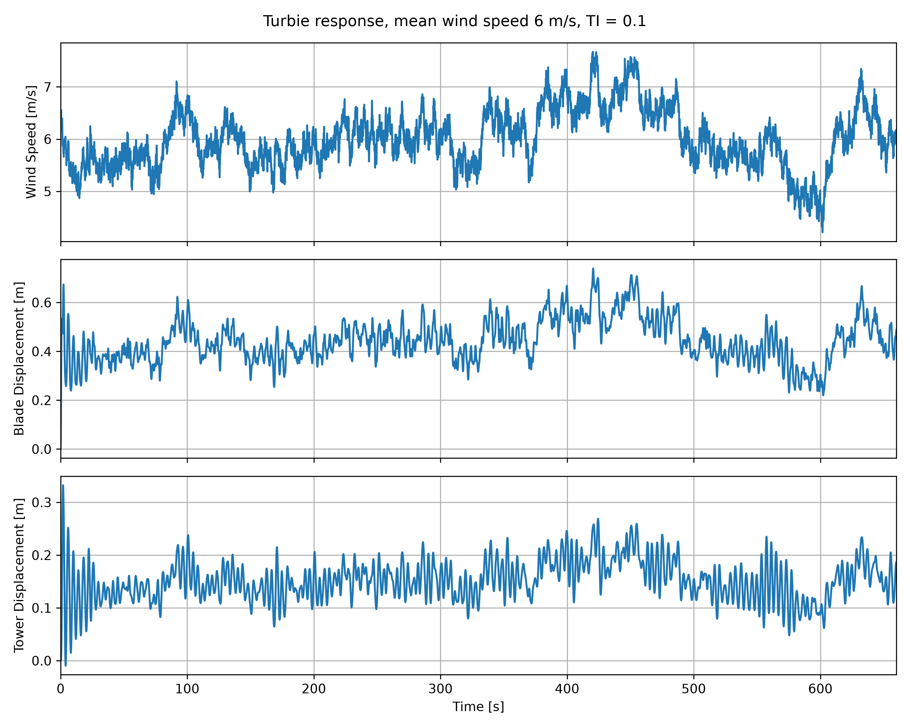
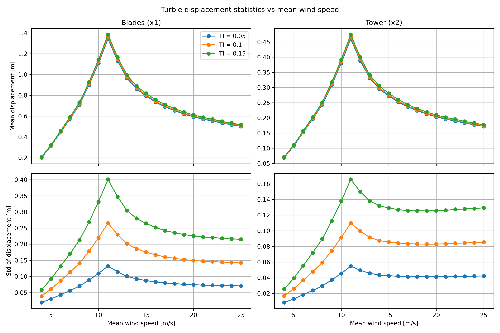

# Project02_46W38

This is the project of the course 46W38.

Simulation of Turbie, a two-degree-of-freedom (2DOF) model of the DTU 10 MW Reference Wind Turbine, forced by turbulent wind.

The model represents the turbine as a forced mass-spring-damper system with two degrees of freedom:

1. x1: deflection of the blades (flapwise of the blades).
2. x2: deflection of the nacelle, hub and tower.

The aerodynamic thrust acts only on the blades and depends on the wind speed relative to the moving blades:

$$
f_{aero}(t) = \tfrac{1}{2} \rho\, C_T A\, \big(u(t) - \dot{x}_1\big)\,\big|u(t) - \dot{x}_1\big|
$$

The thrust coefficient $C_T$ is constant within each simulation and is interpolated from a look-up table using the mean wind speed of the wind file.

## Repository structure

```
Project02_46W38/
├── turbie_mod.py          # Turbie module: input reading, C_T, system matrices, state derivative
├── main.py                # Main script: runs all cases, saves results and plots
├── inputs/
│   ├── turbie_inputs/
│   │   ├── turbie_parameters.txt   # Turbie parameters (masses, damping, stiffness, rotor diameter, air density)
│   │   └── CT.txt                  # Look-up table: wind speed vs thrust coefficient
│   └── wind_files/
│       ├── wind_TI_0.05/           # 22 wind time series, 4 to 25 m/s, TI = 0.05
│       ├── wind_TI_0.1/            # 22 wind time series, 4 to 25 m/s, TI = 0.1
│       └── wind_TI_0.15/           # 22 wind time series, 4 to 25 m/s, TI = 0.15
└── outputs/
    ├── wind_TI_0.05/               # Results and statistics for TI = 0.05
    ├── wind_TI_0.1/                # Results and statistics for TI = 0.1
    ├── wind_TI_0.15/               # Results and statistics for TI = 0.15
    ├── time_series_6_ms_TI_0.1.png
    └── statistics_vs_wind_speed.png
```

### The Turbie module (`turbie_mod.py`)

| Function | Purpose |
|---|---|
| `read_wind_file` | Reads a wind file and returns time and wind speed |
| `read_C_T_table` | Reads the wind speed vs C_T look-up table |
| `get_C_T` | Interpolates C_T from the mean wind speed |
| `read_turbie_parameters` | Reads the 14 Turbie parameters from file |
| `get_turbie_parameters` | Extracts the parameters as individual variables |
| `calculate_MCK_matrix` | Builds the 2x2 mass, damping and stiffness matrices |
| `calculate_rotor_area` | Computes the rotor swept area from the rotor diameter |
| `state_derivative` | Computes the state derivative y'(t), passed to `scipy.integrate.solve_ivp` |

The system matrices are built with $m_1 = 3 m_b$ (three blades) and $m_2 = m_n + m_h + m_t$ (nacelle, hub and tower):

$$
\mathbf{M} = \begin{bmatrix} m_1 & 0 \\ 0 & m_2 \end{bmatrix}, \quad
\mathbf{C} = \begin{bmatrix} c_1 & -c_1 \\ -c_1 & c_1 + c_2 \end{bmatrix}, \quad
\mathbf{K} = \begin{bmatrix} k_1 & -k_1 \\ -k_1 & k_1 + k_2 \end{bmatrix}
$$

The equation of motion $\mathbf{M}\ddot{\bar{x}} + \mathbf{C}\dot{\bar{x}} + \mathbf{K}\bar{x} = \bar{F}(t)$ is written in first-order form with the state vector $\bar{y} = [x_1, x_2, \dot{x}_1, \dot{x}_2]^T$, and the accelerations are obtained with `numpy.linalg.solve`.

### Output files

1. `outputs/wind_TI_*/results_wind_<U>_ms_TI_<TI>.txt`: time series of one case, with columns time [s], wind speed [m/s], x1 [m], x2 [m], x1_dot [m/s] and x2_dot [m/s].
2. `outputs/wind_TI_*/statistics_wind_TI_<TI>.txt`: one row per wind speed, with columns mean wind speed [m/s], mean x1 [m], std x1 [m], mean x2 [m] and std x2 [m].

## How to run

Requirements: Python 3 with NumPy, SciPy and Matplotlib. The project was developed in a conda environment with Python 3.13.

From the root of the repository:

```
python main.py
```

The script simulates the 66 cases (3 TI categories × 22 mean wind speeds), which takes about 10 minutes, and writes all results and figures to `outputs/`.

## Implementation choices

1. Initial conditions: Turbie starts at rest, $\bar{y}(0) = [0, 0, 0, 0]$. Since the wind thrust is applied suddenly, the first seconds show a start-up transient that is not part of the response to the wind.
2. Transient removal: The first 60 s of each simulation are discarded when computing the means and standard deviations, so that the statistics represent the response to the turbulent wind only. The full 660 s are kept in the saved time series and in the time series plot.
3. Saved time resolution: `solve_ivp` returns the solution every 0.01 s, at the same times as the wind files. The statistics are computed from this full resolution, but the time series files are saved every 0.1 s to keep the repository size reasonable (about 20 MB instead of about 240 MB). This still gives about 16 points per cycle of the fastest mode (blades, 0.63 Hz).
4. Input data: The rotor diameter is read from `turbie_parameters.txt` (178 m), which differs slightly from the value in the project description (180 m). The thrust coefficient table is named `CT.txt` in the provided inputs.

## Results

### Time series for one case (6 m/s, TI = 0.1)



The blade displacement follows the wind closely: the gusts around 100 s and 400 s and the lull around 600 s are clearly visible in x1. The tower displacement follows the same slow trend, but it also shows regular oscillations of a few seconds, close to the tower natural frequency (0.25 Hz). The start-up transient is visible during the first 20 to 30 seconds.

### Statistics vs mean wind speed



## Discussion

### Effect of the mean wind speed

1. Mean: Both mean displacements increase with wind speed up to about 11 m/s, where they reach their maximum (about 1.37 m for the blades and 0.47 m for the tower), and then decrease even though the wind keeps increasing. The response is mainly quasi-static, so the mean displacements follow the mean thrust, which is proportional to $C_T U^2$. Below 11 m/s, $C_T$ is high and almost constant, so the thrust grows with $U^2$. Around 11 m/s the DTU 10 MW turbine reaches its rated wind speed. Above it, the blades are pitched to limit power and loads, which in this model appears as a sharp drop of $C_T$ (from 0.814 at 11 m/s to 0.059 at 25 m/s). The product $C_T U^2$ is therefore maximum at 11 m/s and decreases by a factor of about 2.7 up to 25 m/s, which matches the ratio of the mean displacements (1.37 m to 0.51 m for the blades).

    A static check confirms the values: at 11 m/s the mean thrust is about 1.5 MN, which gives $x_2 = F/k_2 \approx 0.46$ m and $x_1 = F/k_1 + F/k_2 \approx 1.33$ m, close to the simulated means. This also explains why the blade displacement is about three times the tower displacement: x1 is measured in the global coordinate system, so it includes the tower motion plus the bending of the blades, and the blades are softer than the tower ($k_1 < k_2$).

2. Standart Deviation:  The standard deviations also peak at 11 m/s. For small fluctuations, the thrust fluctuation is approximately $\sigma_F \approx \rho C_T A U \sigma_u = \rho C_T A U^2 \cdot TI$, so it follows the same $C_T U^2$ trend as the mean thrust.

    Above rated wind speed, however, the standard deviations decrease more slowly than the means, and for the tower they become almost constant or even increase slightly. This is related to the aerodynamic damping. Since the thrust depends on the relative velocity $u - \dot{x}_1$, any blade motion in the direction of the wind reduces the thrust and any motion against it increases the thrust, which damps the oscillations. Linearizing the thrust gives an aerodynamic damping coefficient proportional to $\rho C_T A U$, which is maximum at rated wind speed and drops by a factor of about 6 between 11 and 25 m/s. With less aerodynamic damping, the dynamic (resonant) part of the response becomes relatively more important, especially for the tower, whose structural damping is very low (damping ratio of about 0.3 %).

### Effect of the turbulence intensity

1. Mean: The mean displacements are almost independent of the TI: the three curves nearly overlap. The TI describes the fluctuations around the mean wind speed, not the mean itself. There is only a small increase with TI, because the thrust depends on $u^2$ and the mean of $u^2$ is $U^2(1 + TI^2)$, about 2 % higher for TI = 0.15.

2. Standart deviations:The standard deviations increase strongly and almost linearly with the TI: at a given wind speed, the values for TI = 0.15 are about three times those for TI = 0.05, the same ratio as the TI values. Since $\sigma_u = TI \cdot U$, the thrust fluctuations, and therefore the displacement fluctuations, scale with the TI. For example, at 11 m/s the standard deviation of the blade displacement is about 0.13 m, 0.27 m and 0.40 m for TI = 0.05, 0.1 and 0.15.

### Limitations of the model

1. $C_T$ is constant within each simulation. A real pitch controller adjusts the blade pitch continuously, which would change the loads, especially above rated wind speed.
2. There is no spatial variation of the turbulence, no dynamic inflow, dynamic stall or tower shadow, and only the fore-aft motion is modelled.
3. The statistics depend slightly on the chosen transient removal time (60 s).

